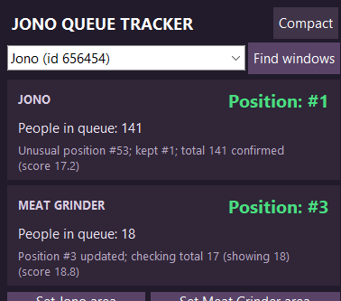
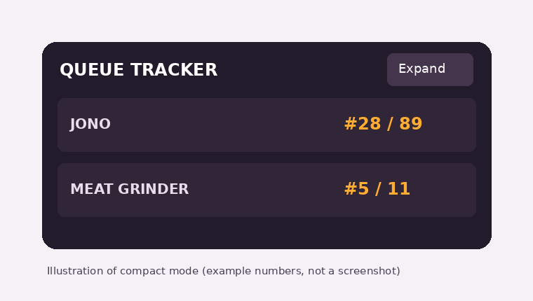
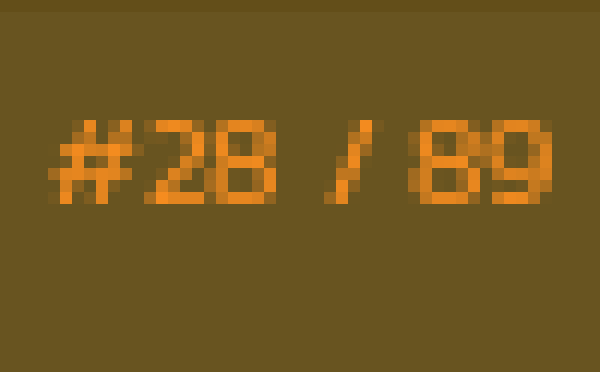

# Jono Queue Tracker

A small, always-on-top **Windows queue tracker** for **Jono** and **Meat Grinder**. It reads the orange `#position / total` queue indicators from the Jono game window and displays them in a floating overlay, so you can keep an eye on the queue while using other apps.

> **Unofficial fan-made tool.** This project is not affiliated with Jono or its developers.

## Preview

### Full tracker



*Example screenshot from an earlier version. The current interface also includes a window selector, diagnostics, and compact mode. The numbers shown in the screenshot are not live.*

### Compact overlay



*Illustration of the current compact layout, not an actual screenshot. Drag the overlay by its header or queue rows; click **Expand** to return to settings.*

### What the tracker reads



*Real queue capture, enlarged for readability. `#28 / 89` means position 28 out of 89.*

## Features

- Tracks **Jono** and **Meat Grinder** separately.
- Refreshes automatically approximately **every 1.5 seconds**.
- Uses Windows background window capture, so the game can be behind another application (capture support varies by game/window state).
- Uses a custom pixel-font recognizer, **not Tesseract**.
- Displays queue position and total number of people.
- Offers an always-on-top, **borderless, draggable compact mode**.
- Shows recognition/capture diagnostics in the expanded window.
- Checks suspicious changes to reduce occasional incorrect readings.

## Download and install (recommended)

1. Open this repository's **[Releases](../../releases)** page.
2. If a Windows `.exe` is published, download **Jono Queue Tracker.exe**.
3. Run the executable. **Python is not required** for a correctly packaged standalone build.
4. If Windows warns about an unsigned or unfamiliar program, verify you downloaded it from the repository you trust before running it.

> **Maintainer note:** The Releases link above will only work after you publish a release and attach your EXE. Until then, use the Python instructions below.

## Run from source (Windows)

You need **Python 3** installed. Download or clone the repository and keep these files together:

```text
jono_queue_tracker.py
jono_digits.py
digit_templates.json
```

Open a terminal in the project folder and install dependencies:

```powershell
py -m pip install pillow numpy pywin32
```

Start the tracker:

```powershell
py jono_queue_tracker.py
```

**Tesseract is not needed.**

## First-time setup

1. **Start Jono** and navigate to the game's **GAMES** panel, where the orange queue indicators appear.
2. **Launch the tracker.** In the expanded window, select the Jono game window from the dropdown. If you don't see it, click **Find windows**.
3. Click **Set Jono area**. A selection overlay appears. **Click and drag a tight rectangle around the entire orange `#position / total` line**, including the `#`, slash, and all digits. Release the mouse to save.
4. Click **Set Meat Grinder area** and select its orange queue line the same way.
5. Check that the positions and totals appear in the tracker. The tracker should update automatically while running.
6. Click **Compact** for a smaller borderless overlay. **Drag it** to move it around your desktop, or click **Expand** to return to the full interface.

**Selection tip:** Keep the game window in its usual position and size after choosing the areas. If the numbers stop updating after you move or resize the game, select the areas again.

## Understanding the display

| Example | Meaning |
| --- | --- |
| `#28 / 89` | You are position **28** out of **89** in that queue. |
| `#5 / 11` | You are position **5** out of **11**. |
| `#— / —` | No valid reading yet; check the selected window and area. |

The tracker may briefly keep an older number while confirming an unusual change. **It is an estimate from the game's on-screen text**, not a direct connection to the game's queue servers.

## Build a standalone Windows EXE

To package the app yourself, install Python and the dependencies above, then install PyInstaller:

```powershell
py -m pip install pyinstaller
```

From the folder containing the three source files, run:

```powershell
py -m PyInstaller --onefile --windowed --clean --name "Jono Queue Tracker" --add-data "digit_templates.json;." jono_queue_tracker.py
```

The output is:

```text
dist/Jono Queue Tracker.exe
```

This bundles the Python runtime and dependencies so **the target Windows PC does not need Python installed**. Build on Windows for Windows. Keep in mind that antivirus/SmartScreen may warn about unsigned executables.

## Troubleshooting

| Problem | What to try |
| --- | --- |
| **No matching Jono pixel-font line found** | Check the game is showing the orange queue text. Re-select a tight area around the whole line. |
| **Queue numbers are blank** | Select the game window and set the two capture areas. |
| **Numbers are incorrect** | Re-select the area; make sure all digits and the slash fit inside. See the debug-image instructions below. |
| **Tracker stops updating after moving Jono** | Re-select the queue areas; coordinates are based on the game's window position. |
| **Background capture is blank** | Make sure Jono is not minimized; try restoring it and selecting the area again. Some capture conditions may return blank frames. |
| **ModuleNotFoundError** | Run `py -m pip install pillow numpy pywin32` in the same Python environment used to launch the app. |
| **The EXE fails to start** | First run the Python script from a terminal to see errors; then rebuild the EXE with `--clean`. |

### Report a recognition bug

The tracker saves its most recent captured queue areas in your **Pictures** folder:

```text
Pictures/jono_debug_jono.png
Pictures/jono_debug_meat_grinder.png
```

When reporting a problem, include **the relevant debug image**, what the game **actually displayed**, and what the tracker **reported**. For example: “Game shows `#28 / 89`, tracker says `#78 / 89`.”

**Privacy tip:** These debug crops should contain only the selected queue area, but review any image before posting it publicly.

## Project files

| File | Purpose |
| --- | --- |
| `jono_queue_tracker.py` | Windows capture, queue state, and Tkinter UI |
| `jono_digits.py` | Custom pixel-font queue text recognition |
| `digit_templates.json` | Trained character patterns used by the recognizer |
| `assets/` | Images used in this README |

## Limitations

- **Windows only** (uses Windows-specific capture APIs).
- The game needs to be running with its queue indicators available to capture.
- Background capture may fail for some window states, including minimization.
- The OCR can occasionally misread digits, especially if the game changes its rendering, resolution, or scale.
- This tool **does not join queues or interact with the game's servers**; it reads what is shown on screen.

## Contributing

Bug reports and improvements are welcome. When filing an issue, include the tracker version, your Windows display scaling if relevant, and a cropped debug screenshot showing the misread text.

---

*Built for keeping an eye on Jono queues without constantly switching windows.*
